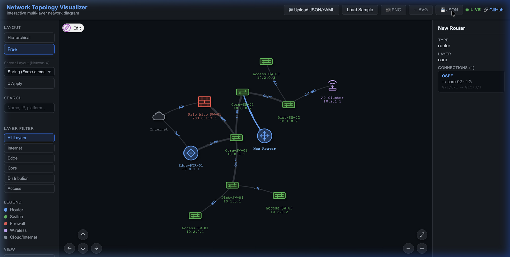
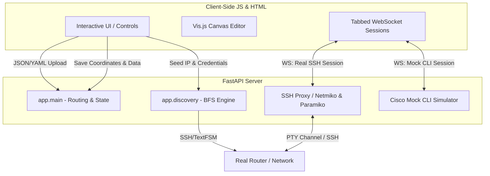

# Network Topology Visualizer

Upload a network inventory (JSON or YAML) or build one from scratch using the Interactive GUI Editor. Get an interactive, zoomable topology diagram featuring custom dark-mode SVG device icons and multi-layer filtering.



## Features

- **Interactive GUI Builder** — Build network diagrams dynamically without writing JSON! Drag and drop nodes, draw connections, and configure device node properties (IP, Layer, Type) through sleek popup modals.
- **Custom Device Icons** — Premium, dark-mode native SVG icons for Routers, Switches, Firewalls, Wireless APs, and Cloud environments.
- **Server-Side State Persistence** — Save your visual coordinates, new nodes, and custom links directly to the server with the **Save to Server** feature to keep layout configurations on page refreshes.
- **Interactive Canvas** — Drag nodes, zoom, pan; click a device or link to see its configuration details in the side panel.
- **Export Capabilities** — Save your visual diagram as **PNG** or **SVG**, or export your custom-drawn network back to a **JSON** file to use in automation workflows.
- **Live Search & Layer Filtering** — Quickly find specific devices by IP/Name, and toggle between Core, Distribution, Access, and Edge views.
- **Dual-Mode Console Shell** — Switch between a stateful Mock router CLI shell or a real Netmiko SSH proxy console connection (with active PTY resize, command history, and canvas path tracing).
- **SSH Neighbor Discovery** — start from a seed device and build the topology from CDP/LLDP neighbors (Netmiko + TextFSM), or use mock discovery for demos.
- **Live Reachability** — background TCP checks (port 22) mark devices up/down with latency.
- **Operations Tools** — runbooks (run commands across devices), path trace with per-hop diagnostics, config audits, IPAM/subnet analysis, topology overview, report export.
- **Layout History** — every save keeps a timestamped backup; compare any two versions of a device's config.

## System Architecture

The following diagram illustrates how the frontend visualizer, WebSocket server, and SSH network discovery components interact:



## Tech Stack

- Python 3.10+ / FastAPI — backend API, WebSocket proxy, & neighbor discovery engine
- Vis.js Network — interactive graph rendering and GUI builder module
- Netmiko & Paramiko — SSH console sessions and queue-based neighbor discovery
- HTML/CSS/JavaScript — vanilla frontend featuring a premium dark mode aesthetic

## Inventory Format

```json
{
  "devices": [
    {
      "id": "core-sw-01",
      "label": "Core Switch 1",
      "type": "switch",
      "layer": "core",
      "ip": "10.0.0.1",
      "platform": "Cisco Catalyst 6509",
      "x": -150.0,
      "y": -200.0
    },
    {
      "id": "dist-sw-01",
      "label": "Dist Switch 1",
      "type": "switch",
      "layer": "distribution",
      "ip": "10.0.1.1",
      "platform": "Cisco Catalyst 4507",
      "x": 100.0,
      "y": 50.0
    }
  ],
  "links": [
    {
      "source": "core-sw-01",
      "target": "dist-sw-01",
      "protocol": "OSPF",
      "source_interface": "Gi1/0/1",
      "target_interface": "Gi1/0/24",
      "bandwidth": "10G"
    }
  ]
}
```

## Pathfinding & Highlight Logic

When there are multiple physical paths between a source and target device across the network:
- **Graph-Theoretic Pathfinding**: For successful pings, the visualizer canvas uses an unweighted **Breadth-First Search (BFS)** algorithm to compute and highlight the shortest hop connection path in electric cyan (`#00d2ff`).
- **Shortest Hop Priority**: The path with the fewest number of hops will always be selected for pings.
- **Tie-Breaker**: If multiple redundant paths of equal hop length exist, the path whose connections are listed first in the active topology JSON dataset is chosen.
- **Real-Time Traceroute Pathfinding**: When performing a `traceroute` or `trace` command in the terminal console, the frontend parses the raw terminal stdout in real-time. Hop IP addresses are matched against topology devices to dynamically light up the true routing path device-by-device in premium orange (`#ff9c3a`), overriding the default client-side BFS calculation.
- **Unreachable Hop Gap Bridging**: If a traceroute encounters unreachable hops (e.g., `* * *`) or unresolvable IPs, the visualizer automatically performs BFS pathfinding between the last known hop and the next responding hop to gracefully bridge the gap and keep the visual path highlight continuous.
- **Highlight Persistence & Reset**: Path highlights remain visible on the canvas during node selections and general canvas interactions. All highlights are automatically cleared and returned to their original styling properties when the terminal drawer is closed or a new traceroute/ping starts.

## Quick Start

```bash
make setup
make run
# Open http://localhost:8000
# Upload your inventory JSON, use the sample topology, or draw your own!
```

The server listens on `127.0.0.1` only. To reach it from other machines, run `HOST=0.0.0.0 make run` — but put it behind an authenticating reverse proxy first (see Security).

## Configuration

| Variable | Default | Purpose |
|---|---|---|
| `HOST` | `127.0.0.1` | bind address for `make run` |
| `TOPOLOGY_DATA_DIR` | `data/` | where saved layouts, the active `topology.json` and backups are stored; seeded from `sample/*.json` on first start |
| `TOPOLOGY_API_KEY` | unset | when set, `POST /api/push` requires a matching `X-API-Key` header |
| `CORS_ORIGINS` | unset (CORS off) | comma-separated exact origins allowed to call the API from another site |

`data/` is gitignored, so saved topologies (which contain real IPs and hostnames) never end up in commits. `sample/` holds only the bundled example layouts.

## Security

This tool can open SSH sessions to network devices, so treat it as an admin tool:

- Device credentials are entered per session and sent in the request body or the first WebSocket message — never in URLs — and are not stored.
- Only `/api/push` supports an API key; the rest of the API has no authentication. Keep the default localhost binding, or add authentication in front of it.
- Cross-site requests are blocked: CORS is off unless `CORS_ORIGINS` is set, and the WebSocket endpoints reject connections from other origins.
- Device-supplied strings (hostnames, interface names, configs) are HTML-escaped before display.
- vis-network is loaded from unpkg with a Subresource Integrity hash.

## Development

```bash
make setup              # uv sync (includes pytest, ruff)
make lint               # ruff check + JSON syntax check
uv run pytest -q        # tests use a temporary data directory, never sample/ or data/
```

CI runs lint and tests on every pull request. An optional SSH test router: `docker compose -f docker-compose.test-router.yml up -d`.

Agent and contributor docs: [CLAUDE.md](CLAUDE.md) and [docs/](docs/).
